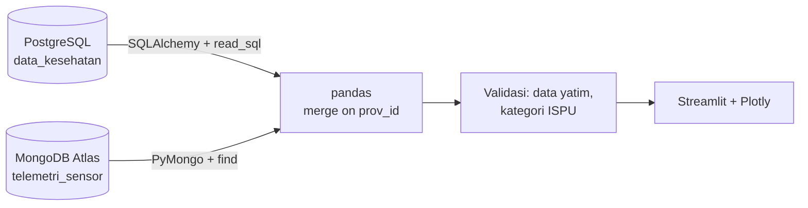

# Multi-DBMS Data Pipeline: Karhutla, ISPA & Asap Lintas Negara

Tugas Mandiri Terstruktur — Visualisasi Data dan Informasi.
Dashboard interaktif yang menggabungkan **PostgreSQL** (data kesehatan) dan **MongoDB Atlas** (telemetri sensor & geospasial) di tingkat aplikasi dengan **pandas**, lalu menampilkannya dengan **Streamlit + Plotly**.

- **Live app:** `[ISI: URL Streamlit Community Cloud]`
- **Repositori:** `[ISI: URL GitHub ini]`

## 1. Studi kasus & alasan memakai dua DBMS

Kebakaran hutan dan lahan (karhutla) memicu kabut asap yang berdampak pada kesehatan (ISPA) dan melintasi batas negara. Dua jenis data dengan karakter berbeda dipisah sesuai kekuatan masing-masing DBMS:

| DBMS | Engine | Fungsi | Alasan |
|---|---|---|---|
| 1 | PostgreSQL (Supabase/Neon) | Data master provinsi & kesehatan (`data_kesehatan`) | Struktur tetap, butuh constraint (PK, UNIQUE, CHECK) |
| 2 | MongoDB Atlas | Telemetri sensor & geospasial (`telemetri_sensor`) | Dokumen fleksibel; `negara_terdampak` berupa array, field sensor bisa bertambah |

Kunci integrasi: `prov_id`.

## 2. Arsitektur & alur pipeline



1. `load_postgres()` membaca tabel dengan SQLAlchemy; `load_mongo()` membaca koleksi dengan PyMongo dan menormalkan skema.
2. `integrate()` melakukan `merge(..., on="prov_id", validate="one_to_one")` dan melaporkan `prov_id` yang hanya ada di salah satu DBMS.
3. Nilai ISPU dikelompokkan ke kategori resmi (Baik … Berbahaya), lalu difilter dan divisualkan.
4. Hasil dimuat dengan cache 10 menit; tombol "Muat ulang data" membersihkan cache.
5. Jika koneksi gagal, aplikasi masuk **mode demo** dengan banner peringatan dan status koneksi di sidebar (tidak diam-diam memakai data palsu).

## 3. Fitur interaktif

- Filter pulau, provinsi, dan rentang nilai ISPU (sidebar)
- Status peringatan berdasarkan kategori ISPU tertinggi
- Peta sebaran hotspot (ukuran = hotspot, warna = kategori ISPU) dengan hover detail
- Grafik negara tetangga terdampak
- Scatter ISPU vs korban meninggal dengan garis tren dan koefisien korelasi (n ditampilkan)
- Bar chart korban, hotspot, dan luas lahan terbakar
- Tabel hasil join + unduh CSV
- Indikator status koneksi tiap DBMS dan tombol muat ulang

## 4. Struktur repositori

```
app.py                       # aplikasi Streamlit
requirements.txt
database/
  schema.sql                 # DDL PostgreSQL + dokumentasi skema MongoDB
  seed_data.py               # seed PostgreSQL & MongoDB (idempotent)
  seed_mongodb.json          # seed MongoDB dalam JSON (untuk mongoimport)
  reference_data.py          # sumber tunggal data seed
  connections.py             # pembangun URL koneksi
.streamlit/secrets.toml.example
```

## 5. Konfigurasi & menjalankan

```bash
pip install -r requirements.txt
cp .streamlit/secrets.toml.example .streamlit/secrets.toml   # isi kredensial
python database/seed_data.py                                  # isi kedua database
streamlit run app.py
```

Kredensial dibaca dari `st.secrets` / environment variable. **Tidak ada password di kode.**
Variabel: `PG_URL` (atau `PG_HOST`, `PG_PORT`, `PG_DB`, `PG_USER`, `PG_PASS`, `PG_SSLMODE`), `MONGO_URI`, `MONGO_DB`, `MONGO_COLLECTION`.

**Deploy (Streamlit Community Cloud):** hubungkan repo, pilih `app.py`, lalu tempel isi secrets di *Settings → Secrets*.

Catatan:
- Supabase: koneksi langsung (`db.<ref>.supabase.co`) memakai IPv6 dan bisa gagal dari Streamlit Cloud (`Network is unreachable`). Gunakan connection string **pooler** dari dashboard Supabase.
- MongoDB Atlas: tambahkan IP yang diizinkan (Network Access) agar Streamlit Cloud dapat terhubung.

## 6. Sumber data (primer)

> Isi dengan tautan dataset asli sebelum dikumpulkan. Contoh portal: SiPongi KLHK (hotspot & luas karhutla), BMKG / KLHK (ISPU & PM2.5), Kemenkes / BPS (ISPA), Satu Data Indonesia.

| Data | Sumber | URL |
|---|---|---|
| Kasus ISPA & korban | `[ISI]` | `[ISI]` |
| Hotspot & luas lahan terbakar | `[ISI]` | `[ISI]` |
| ISPU | `[ISI]` | `[ISI]` |
| Negara terdampak | `[ISI]` | `[ISI]` |

**Status data seed:** `[ISI: "Diambil dari sumber di atas pada <tanggal>" ATAU "Data ilustratif/simulasi untuk keperluan demonstrasi"]`

Kategori ISPU mengacu pada Permen LHK No. P.14/MENLHK/SETJEN/KUM.1/7/2020 (verifikasi di dokumen resmi).

## 7. Referensi kode / inspirasi

`[ISI: tautan repositori publik atau dokumentasi yang benar-benar dipelajari/diadaptasi]`

## 8. Keterbatasan

- Data berupa satu snapshot per provinsi (belum ada dimensi waktu).
- Jumlah korban/ISPA bersifat absolut dan belum dinormalisasi per jumlah penduduk, sehingga provinsi padat penduduk (mis. di Jawa) tidak sebanding langsung dengan provinsi lain.
- Korelasi pada n kecil bersifat indikatif, bukan bukti sebab-akibat.
