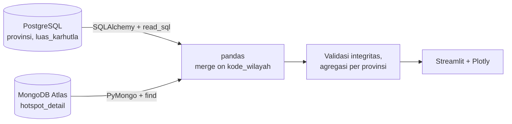

# Karhutla Indonesia: Multi-DBMS Data Pipeline & Web Visualization

Tugas Mandiri Terstruktur — Visualisasi Data dan Informasi.
Dashboard interaktif yang menggabungkan **PostgreSQL** (luas karhutla per provinsi-tahun) dan **MongoDB Atlas** (titik hotspot berkoordinat) di tingkat aplikasi dengan **pandas**, lalu menampilkannya dengan **Streamlit + Plotly**.

- **Live app:** `[ISI: URL Streamlit Community Cloud]`
- **Repositori:** `[ISI: URL GitHub ini]`
- **Sumber data:** SIPONGI KEMENHUT (lihat bagian 6)

## 1. Studi kasus & alasan memakai dua DBMS

Kebakaran hutan dan lahan (karhutla) dipantau dari dua sisi: **dampak historis** (luas lahan terbakar per provinsi tiap tahun) dan **kejadian terkini** (titik panas satelit berkoordinat). Keduanya berbeda karakter, sehingga dipisah sesuai kekuatan tiap DBMS:

| DBMS | Engine | Fungsi | Alasan |
|---|---|---|---|
| 1 | PostgreSQL (Supabase/Neon) | `provinsi` + `luas_karhutla` (provinsi × tahun, 2018–2026) | Struktur tetap, butuh PK, FK, UNIQUE, CHECK |
| 2 | MongoDB Atlas | `hotspot_detail` (1.276 titik: desa, satelit, confidence, waktu, lokasi GeoJSON) | Dokumen kejadian berlokasi, skema fleksibel, indeks geospasial `2dsphere` |

Kunci integrasi: `kode_wilayah` (kode 2 digit provinsi).

## 2. Arsitektur & alur pipeline



1. `load_postgres()` menggabungkan `luas_karhutla` dan `provinsi` (JOIN SQL) lalu memuatnya ke DataFrame.
2. `load_mongo()` membaca dokumen hotspot dan menormalkan skema (koordinat dari GeoJSON, waktu ke WIB).
3. Hotspot diagregasi per provinsi, lalu `merge(..., on="kode_wilayah", validate="one_to_one")` dengan luas karhutla tahun fokus. Kode wilayah hotspot tanpa master provinsi dilaporkan.
4. Hasil di-cache 10 menit; tombol "Muat ulang data" membersihkan cache.
5. Jika koneksi gagal, aplikasi menampilkan penyebab spesifik (password disensor) dan berhenti. Tidak ada data pengganti: semua angka selalu berasal dari kedua database.

## 3. Fitur interaktif

- Filter: rentang tahun, tahun fokus, wilayah, provinsi, satelit, confidence
- Peta hotspot (mode **Titik** berwarna per confidence, atau **Kepadatan**) dengan hover detail desa/satelit/waktu
- Tren total luas karhutla, luas per wilayah, 10 provinsi terluas, heatmap provinsi × tahun
- Analisis gabungan PostgreSQL × MongoDB: luas karhutla vs hotspot dengan korelasi Spearman (n ditampilkan)
- Tabel data + unduh CSV, status koneksi tiap DBMS, tombol muat ulang

## 4. Struktur repositori

```
app.py                          # aplikasi Streamlit
requirements.txt
data/
  raw/                          # berkas mentah SiPongi+ (xlsx)
  luas_karhutla_provinsi.csv    # -> PostgreSQL
  hotspot_detail.csv            # -> MongoDB
  README.md                     # kamus data, transformasi, validasi
database/
  schema.sql                    # DDL PostgreSQL + dokumentasi skema MongoDB
  prepare_data.py               # xlsx mentah -> CSV bersih (dengan validasi)
  seed_data.py                  # seed PostgreSQL & MongoDB
  data_loader.py                # membaca & memvalidasi CSV
  connections.py                # pembangun URL koneksi (tanpa kredensial)
.streamlit/secrets.toml.example # contoh secrets (secrets asli tidak di-commit)
```

## 5. Konfigurasi & menjalankan

```bash
pip install -r requirements.txt
cp .streamlit/secrets.toml.example .streamlit/secrets.toml   # isi kredensial
python database/seed_data.py                                  # isi kedua database
streamlit run app.py
```

Kredensial dibaca dari `st.secrets` / environment variable. **Tidak ada password di kode.**
Variabel: `PG_URL` (atau `PG_HOST`, `PG_PORT`, `PG_DB`, `PG_USER`, `PG_PASS`, `PG_SSLMODE`), `MONGO_URI`, `MONGO_DB`.

**Deploy (Streamlit Community Cloud):** hubungkan repo, pilih `app.py`, tempel isi secrets di *Settings → Secrets*.

Catatan:
- Supabase: koneksi langsung (`db.<ref>.supabase.co`) memakai IPv6 dan bisa gagal dari Streamlit Cloud (`Network is unreachable`). Gunakan connection string **pooler**.
- MongoDB Atlas: di Network Access izinkan akses dari Streamlit Cloud (IP dinamis, umumnya `0.0.0.0/0`; gunakan password kuat).
- Seed koleksi hotspot bersifat snapshot: isinya diganti seluruhnya setiap dijalankan.

## 6. Sumber data (primer)

**SIPONGI KEMENHUT** — SiPongi+ Sistem Pemantauan Karhutla, Kementerian Kehutanan (https://sipongi.gakkum.kehutanan.go.id/), diakses 12 November 2026. SiPongi+ mewajibkan pencantuman sumber ini pada setiap penggunaan datanya.

| Data | Berkas mentah | URL halaman data |
|---|---|---|
| Luas karhutla per provinsi 2018–2026 | `data/raw/luas-karhutla-provinsi.xlsx` | `[ISI: URL halaman SiPongi+ tempat unduhan]` |
| Sebaran hotspot (11–12 Nov 2026) | `data/raw/sebaran-hotspot.xlsx` | `[ISI: URL halaman Data → Hotspot]` |

Validasi: total tahunan pada berkas luas (mis. 2022: 204.894 ha; 2023: 1.161.192,9 ha; 2024: 376.805,05 ha) sama dengan angka yang dilaporkan media yang merujuk SiPongi; jumlah per provinsi cocok dengan baris Total; total titik hotspot pada sheet `Akumulasi` dan `Detail` sama (1.276). Rincian transformasi: `data/README.md`.

## 7. Referensi kode / inspirasi

| Repositori | Teknik yang dirujuk |
|---|---|
| [SofianeOuaari/Data-Streaming-Kafka-MongoDB-PostgreSQL-Streamlit](https://github.com/SofianeOuaari/Data-Streaming-Kafka-MongoDB-PostgreSQL-Streamlit) | Menyimpan data di MongoDB (NoSQL) dan PostgreSQL (SQL) sekaligus, `init.sql` untuk inisialisasi skema, dashboard Streamlit yang membaca keduanya |
| [Leonardobrito95/comercial-dashboard](https://github.com/Leonardobrito95/comercial-dashboard) (MIT) | Memisahkan modul koneksi tiap DBMS, konfigurasi lewat environment variable, menyatukan data MongoDB + SQL di satu panel Streamlit + Plotly |

Dokumentasi resmi: [Streamlit](https://docs.streamlit.io), [Plotly](https://plotly.com/python/), [SQLAlchemy](https://docs.sqlalchemy.org), [PyMongo](https://pymongo.readthedocs.io).
Kode pada repositori ini ditulis sendiri; repositori di atas hanya menjadi rujukan pola arsitektur.

## 8. Keterbatasan

- Hotspot adalah **snapshot ±24 jam** (11–12 Nov 2026), bukan deret waktu. Hotspot juga hanya indikasi anomali suhu satelit, bukan kepastian kebakaran, dan satu kebakaran bisa terdeteksi sebagai beberapa titik.
- Luas karhutla 2026 adalah data berjalan. Angka 2025 (12.226,72 ha) jauh lebih rendah dari tahun lain; ini apa adanya dari berkas SiPongi dan belum diverifikasi lebih lanjut.
- Korelasi luas vs hotspot bersifat indikatif: periode dan sifat datanya berbeda (akumulasi tahunan vs snapshot).
- `IKN` pada hotspot dikelompokkan ke Kalimantan Timur (asumsi; nama asli disimpan).
- Data dampak kesehatan (ISPA) dan kualitas udara (ISPU) tidak dimasukkan karena tidak tersedia sebagai data terbuka yang dapat diunduh.
